# Wood and Steel

### Rulebook — playtest draft

*2 to 5 players · playing time ⚑Q1*

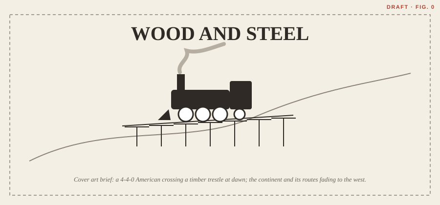

---

## Contents

0. [How to Use This Book](#how-to-use-this-book)
1. [Welcome, Rail Baron](#welcome-rail-baron)
2. [Components](#components)
3. [The Table and the App](#the-table-and-the-app)
4. [Setup](#setup)
5. [Core Concepts](#core-concepts)
6. [Your Turn](#your-turn)
7. [Actions](#actions)
8. [Upgrades](#upgrades)
9. [End of the Round](#end-of-the-round)
10. [End of the Game](#end-of-the-game)
11. [Fine Print](#fine-print)
12. [Rules in Development](#rules-in-development)
13. [Questions and Answers](#questions-and-answers)
14. [Glossary](#glossary)
15. [Index](#index)

The [Quick Reference](Quick%20reference.md) is a separate sheet: one copy per player.

---

## How to Use This Book

Read sections 1 to 7 before your first game. That's enough to play. Look up [Upgrades](#upgrades) when someone first buys one, and [End of the Game](#end-of-the-game) when someone nears 30 Railroad Ties.

This book uses four kinds of callout. Each has its own look, and you can skip all of them on a first read: every rule is in the main text.

> **KEY CONCEPT.** An idea the rest of the rules build on.

> **EXAMPLE.** A worked example of the rule beside it. The same three players, **Red**, **Blue** and **Orange**, appear in every example.

> **IN THE APP.** Where to tap. The app does the arithmetic; the rule is always in the main text.

> **TIP.** Advice for your first games, and rules people often forget.

Terms with a capital letter, like **Route** or **Private Contract**, are game terms. Each is defined in bold where it first appears and listed in the [Glossary](#glossary).

⚑ marks a question for the designer. The [editor's notes](EDITOR_NOTES.md) list them all. They'll be gone from the finished book.

---

## Welcome, Rail Baron

It's the age of steam. You own a two-city railroad on the East Coast, and the rest of the continent is wide open, dotted with small independent lines.

**You win by having the most Railroad Ties at the end of the game.** You earn them mostly by delivering goods under contract. The farther goods travel across the map's six regions, the more Railroad Ties a delivery earns. More come from buying out independent railroads and, at the end, from the variety and volume of what you've delivered.

**The game ends** when one player has 30 Railroad Ties from deliveries. Then everyone adds their end-of-game bonuses.

**The loop.** Every turn you take two Actions. You run your engines to pick up goods and deliver them, which pays cash and Railroad Ties. You spend that cash, and money you borrow, on new track, faster engines and Upgrades, so that you can make bigger deliveries. Between rounds, the independent railroads grow and new contracts appear.

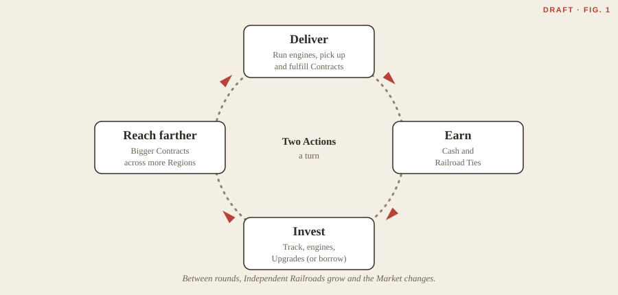

---

## Components

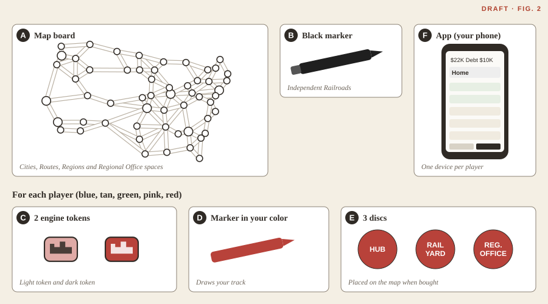

**Shared**

| | Component | Used for |
|---|---|---|
| A | Map board | Cities, Routes, Commodities, Regions, Regional Office spaces |
| B | Black erasable marker | Drawing the Independent Railroads' Routes |

**For each player**

| | Component | Used for |
|---|---|---|
| C | 2 engine tokens, one light and one dark | Where your Engines are |
| D | Erasable marker in your color | Drawing your track |
| E | 3 discs: Hub, Railyard, Regional Office | Marking those Upgrades on the map |

**Not in the box**

| | Item | Used for |
|---|---|---|
| F | A phone, tablet, or laptop for each player to run the Wood and Steel player page | Money, Contracts, Engines, Upgrades, Railroad Ties, and the Independent Railroads |

---

## The Table and the App

> **KEY CONCEPT.** *The table tracks where things are. The app tracks what you own.*

Wood and Steel is played on a board where the track is drawn and Engine and other tokens are moved. Each player also has the app open on their own phone.

| On the table | In the app |
|---|---|
| Your track (drawn on the map) | Your Cash and Debt |
| Where your Engines are | Your Engine types (which is on the light token, which on the dark), cargo, Contracts, and the Market |
| Your Hub, Railyard and Regional Office discs | Your Upgrades |
| The Independent Railroads' Routes | Railroad Ties, rounds, whose turn it is |
| | The Independent Railroads, their Routes and prices |

The app does not know about your track or where your Engines are.

> **IN THE APP.** Your Cash, Debt and Railroad Ties are always at the top of every screen, with a **Loans** button. Tap or click another player to see a summary of their status. On your turn, take two actions using the app and the board, and then press **End Turn** to pass play to the next player.

---

## Setup

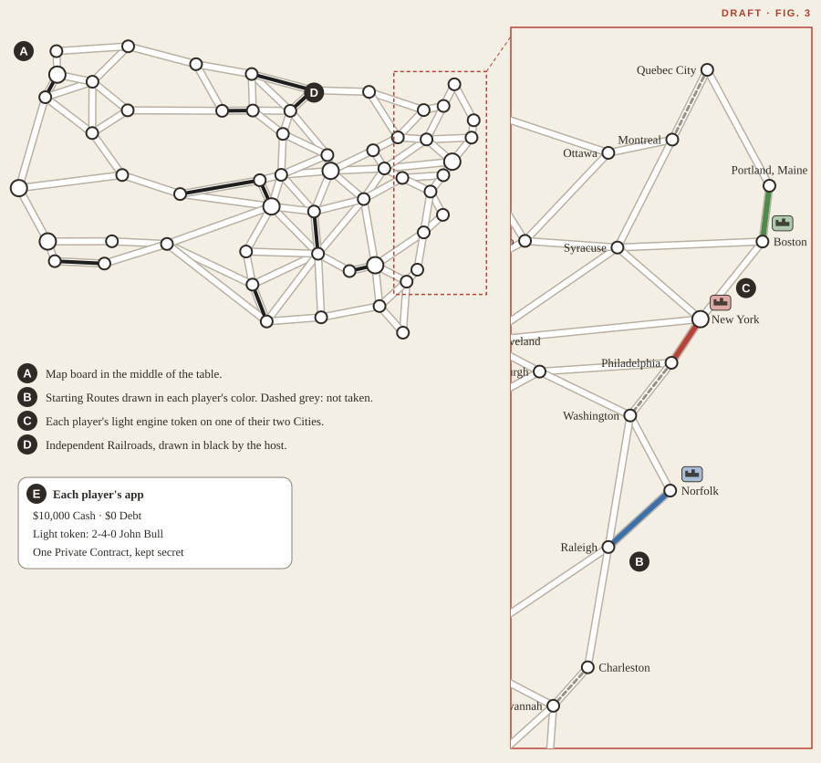

### Table

1. Put the map board in the middle of the table, where everyone can reach it **(A)**.
2. Each player chooses a color and takes the 2 engine tokens, marker pen, and 3 upgrade discs of their color.

### App

3. One player, the host, opens the app at woodandsteel.pettiross.com, chooses the number of players, and shares the 5-letter game code or QR code so other players can join the game.
4. The app chooses the player order at random. This order stays the same all game.
5. In player order, each player chooses a Starting Route in the app:

   | Starting Route | Note |
   |---|---|
   | Montreal – Quebec City | |
   | Boston – Portland ME | |
   | New York – Philadelphia | *shares Philadelphia with the next one* |
   | Philadelphia – Washington | *shares Philadelphia with the one above* |
   | Norfolk – Raleigh | |
   | Charleston – Savannah | |

   No two players may share a Starting Route or a City, so only one player can take a Route through Philadelphia.

6. Draw your Starting Route on the map with your marker, and put your lighter-colored engine token on either of its two Cities **(C)**.
7. When everyone has chosen, the app places the Independent Railroads. Draw each of their Routes on the map with the black marker.
8. The app deals each player a Private Contract **(E)**, which they can see in their app.

### Starting state

Each player begins with:

- $10,000 Cash and $0 Debt
- One Engine, the 2-4-0 John Bull (Range 1), on the lighter-colored token
- One Private Contract

The first player in the app's order takes the first turn.

---

## Core Concepts

### Cities and Routes

A Route is the line between two neighboring Cities. Each Route has its build price printed on it. A mountain symbol marks a Mountain Route; these are more expensive to build.

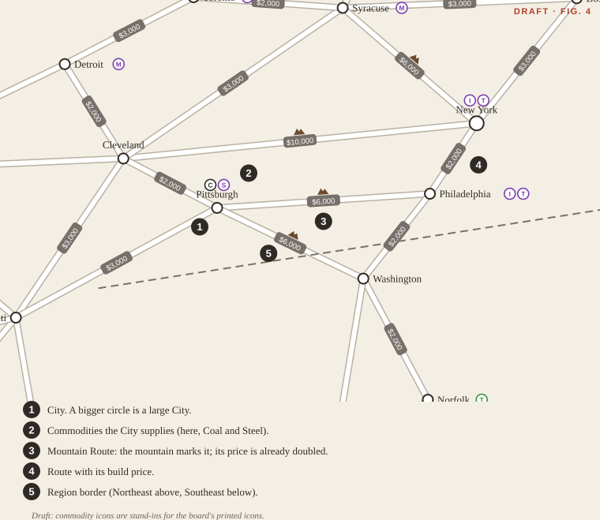

Movement and building count Routes: an Engine with Range 3 moves along up to 3 Routes. Route price does not affect how far an Engine can travel.

### Your Network

Your Network is every Route you've built or acquired as part of an Independent Railroad. Your Engines move only along your Network. More than one player may build on the same Route (see [Parallel track](#build-track)); nobody may build on a Route that belongs to an Independent Railroad.

### Commodities and Cargo

A Commodity is a good like coal or cattle. The icons next to a City show which Commodities it supplies. There are 25 Commodities; their colors and groups (Metals, Crops…) are only decoration.

An Engine carries at most one Commodity at a time: its Cargo. Picking up Cargo is free (see [Free Actions](#free-actions)).

### Engines

An Engine is one of your two engine tokens plus the engine type the app shows for it. Its Range is how many Routes it can move each time it runs. You start with one Engine and may own two. See [Buy an Engine](#buy-an-engine).

### Contracts

A Contract names a Commodity and a destination City. Deliver that Commodity there and you fulfill the Contract: it pays Cash and Railroad Ties.

- A Private Contract is yours alone. You always have exactly one.
- A Market Contract is open to everyone, in the Market of 3 Contracts shown on everyone's Home. The Market opens the first time any player buys a 2-6-0 Mogul or better. You must claim a Market Contract before you can fulfill it, and you may hold one claimed Market Contract at a time. See [Claiming a Market Contract](#claiming-a-market-contract).

> **KEY CONCEPT: How a Contract is valued.** The app works this out and shows it on every Contract.
>
> - **Cash:** $3,000 for every Route between the destination and the nearest City that supplies the Commodity, counted along the map's shortest path, not your track.
> - **Railroad Ties:** 1, plus 1 for each Region border between the destination and the nearest Region that supplies the Commodity, up to a maximum of 4. See Fig. 5.
>
> The amount the app shows you is **net**: it already takes off any [Debt Service](#debt-service) you'd owe.

### Regions

The map is split into six Regions, three across and two down: Northwest, North Central, Northeast, Southwest, South Central, Southeast. The two Central Regions together are the Central Regions; the Northwest and Southwest are the Western Regions.

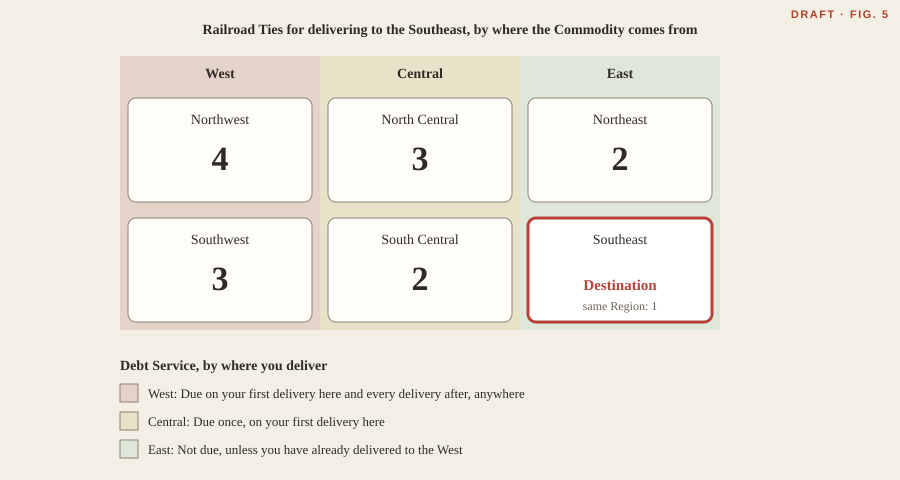

Regions matter for Railroad Ties (above), for [Debt Service](#debt-service), for the price of [Independent Railroads](#acquire-an-independent-railroad), and for the [Regional Office](#regional-office).

### Money

Cash is the money you have. Debt is the money you've borrowed. Both are public, and the app tracks both.

> **KEY CONCEPT.** Your Cash can never go below $0. If you can't afford something, you must borrow first. Borrowing is itself an Action, so plan ahead. See [Borrow Money](#borrow-money).

### Railroad Ties

Railroad Ties are victory points. You earn them during the game by fulfilling Contracts and by acquiring Independent Railroads, and at the end from bonuses. Only Railroad Ties from Contracts and acquiring Independent Railroads count toward the 30 that end the game.

---

## Your Turn

On your turn:

1. **Take up to 2 Actions**, in any order, from the list below. You may take the same Action twice only if it is **Run Trains**.
2. **Take any Free Actions** you want, at any time during your turn.
3. **Press End Turn** in the app.

When the last player in order ends their turn, the round ends: see [End of the Round](#end-of-the-round).

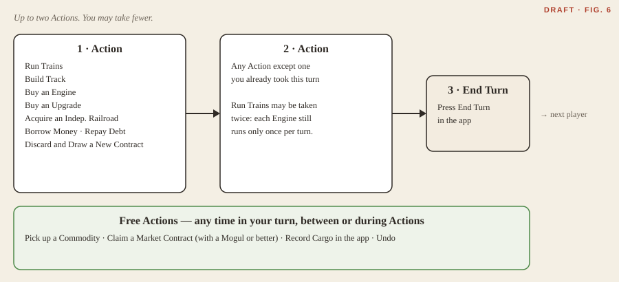

### Actions

| Action | Cost | In short |
|---|---|---|
| [Run Trains](#run-trains) | — | Move one or both Engines; pick up and deliver |
| [Build Track](#build-track) | Printed price per Route, more for parallel tracks | Draw up to 2 new Routes |
| [Buy an Engine](#buy-an-engine) | $5,000 – $30,000 | Get a faster Engine |
| [Buy an Upgrade](#buy-an-upgrade) | $10,000 – $20,000 | Get a permanent advantage |
| [Acquire an Independent Railroad](#acquire-an-independent-railroad) | $3,000 or $4,000 per Route | Add its Routes to your Network; +1 Railroad Tie |
| [Borrow Money](#borrow-money) | — | Take $5,000 or more as Cash and Debt |
| [Repay Debt](#repay-debt) | $5,000 or $10,000 | Pay down Debt |
| [Discard and Draw a New Contract](#discard-and-draw-a-new-contract) | — | Swap your Private Contract for one of new offers |
| [Go First Next Round](#go-first-next-round) | — | Rotate player order so you are first to go |

### Free Actions

Free Actions don't count toward your 2 Actions. You may take them any time during your own turn, including in the middle of an Action, but never during another player's turn.

- **Pick up a Commodity** with an empty Engine that is in a City supplying it: where it starts, any City it passes through, where it stops, or where it was just placed.
- **Claim a Market Contract** when you pick up its Commodity. See [Claiming a Market Contract](#claiming-a-market-contract).
- **Record Cargo** in the app. This is optional: it's a reminder to help you keep track.
- **Undo** in the app, which takes the whole turn back to its start. Put the table back the same way.

> **TIP.** The app doesn't count your Actions. It's helpful (and friendly) to narrate your actions out loud as you take them.

---

## Actions

### Run Trains

*The whistle blows, and freight rolls.*

**Cost:** None.

This Action lets you move one or both of your Engines along your Network, each up to its Range.

- Each Engine may run only once per turn. To run both Engines in different Actions (say, run one, build track, then run the other), take Run Trains twice.
- An Engine may stop short of its Range.
- Engines move only along Routes in your Network. Any number of Engines may be in a City.
- As an Engine moves, it may pick up and deliver: see [Free Actions](#free-actions) and [Fulfilling a Contract](#fulfilling-a-contract).

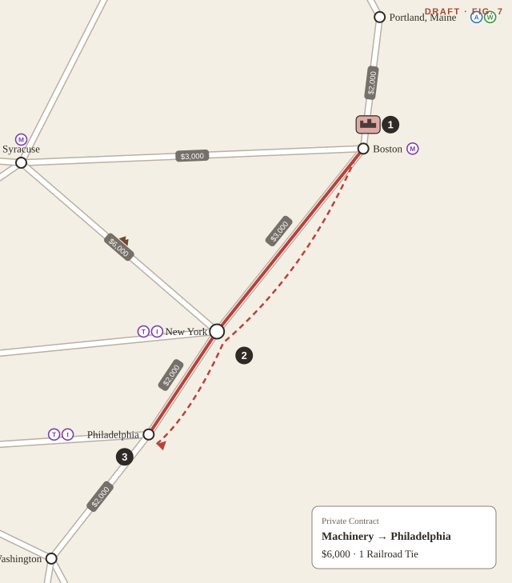

> **EXAMPLE.** Red's Network is New York – Philadelphia and New York – Boston. Red's 4-4-0 American (Range 2) is empty in Boston, and Red's Private Contract is *Machinery to Philadelphia: $6,000, 1 Railroad Tie*.
>
> Red takes Run Trains. Boston supplies Machinery, so the American picks it up for free **(1)**, then moves Boston → New York **(2)** → Philadelphia **(3)**: 2 Routes, its full Range. In Philadelphia, Red fulfills the Contract: +$6,000 and +1 Railroad Tie. No Debt Service is due, since Philadelphia is in the Northeast. Red chooses a new Private Contract, then takes a second Action.

#### Claiming a Market Contract

This lets you reserve a Market Contract for yourself.

- You may claim only if you own a 2-6-0 Mogul or better.
- You claim when one of your Engines picks up the Commodity the Market Contract names. Claiming is a Free Action.
- You may hold only one claimed Market Contract at a time.
- A claimed Market Contract leaves the Market and is yours alone. The app deals a new one into the Market right away. If the claimed one was counting down to expire, its countdown stops.

> **EXAMPLE.** Blue owns a 2-6-0 Mogul in Norfolk. The Market shows *Tobacco to Chicago: $9,000, 3 Railroad Ties*. Norfolk supplies Tobacco, so Blue's Mogul picks some up and Blue claims the Contract in the app. A new Contract fills the Market. Blue can't claim another until this one is fulfilled.

> **IN THE APP.** Press the Market Contract, then **Claim**. The app offers to record the Cargo on one of your Engines.

#### Fulfilling a Contract

When an Engine carrying a Commodity is in the destination City of one of your Contracts for that Commodity, you may fulfill that Contract. "Your Contracts" means your Private Contract and your claimed Market Contract.

1. **The Engine stops.** Its movement ends in that City, even if it has Range left (unless you own a [Timetable](#timetable)). The Commodity is used up; the Engine is now empty.
2. **Collect the payment and Railroad Ties.** You receive the Contract's value, plus any Engine and Upgrade bonuses, minus any [Debt Service](#debt-service) due. If Debt Service is more than the payment, you pay the difference from your Cash.
3. **Choose a new Private Contract.** If you are fulfilling your Private Contract, the app offers new Private Contracts. You must choose one. You get 2 offers, plus 1 with a [Hub](#hub), plus 1 with a [Regional Office](#regional-office).

> **IN THE APP.** Press the Contract. The receipt shows the payment line by line. Confirm to collect.

#### Debt Service

Debt Service is $1,000 for every $5,000 of Debt you have. Whether it's due on a delivery depends on where you've delivered so far:

| Where you have delivered | Debt Service due on this delivery |
|---|---|
| Only the Northeast and Southeast (so far) | None |
| Your first delivery to a Central Region | Once, on that delivery |
| Your first delivery to a Western Region, and every delivery after it, anywhere | Every time |

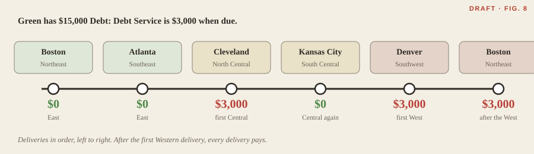

> **EXAMPLE.** Orange has $15,000 Debt, so Debt Service is $3,000.
>
> - Orange delivers to Boston (Northeast), then Atlanta (Southeast): nothing due.
> - Orange delivers to Cleveland (North Central), Orange's first Central delivery: $3,000 due, once.
> - Orange delivers to Kansas City (South Central): nothing due. The Central payment is done.
> - Orange delivers to Denver (Southwest): $3,000 due. From now on, $3,000 is due on **every** delivery, even back in Boston.

> **TIP.** The app won't let you make a delivery you can't pay for. If Debt Service is more than the payment plus your Cash, borrow first. (The full bankruptcy rules are [in development](#rules-in-development).)

**See also:** [Borrow Money](#borrow-money), [Repay Debt](#repay-debt).

### Build Track

*Survey the line, lay the ties, drive the spikes.*

**Cost:** The price printed on each Route, adjusted as below.

This Action lets you draw up to 2 new Routes in your color.

- Each new Route must touch your Network, or the other Route you build in the same Action.
- You may not build on a Route that belongs to an Independent Railroad.
- **Parallel track:** you may build a Route that other players have already built. It costs $1,000 more ($2,000 more on a Mountain Route), however many players are already on it. Draw your line beside theirs.
- With an [Employment Office](#employment-office), you may build 3 Routes instead of 2.
- With a [Hub](#hub), some Routes cost $1,000 less.

| You pay | Nobody on the Route yet | Parallel |
|---|---|---|
| Route ($2,000 – $6,000 printed) | Printed price | Printed price + $1,000 |
| Mountain Route ($4,000 – $12,000 printed) | Printed price | Printed price + $2,000 |
| With a Hub discount | $1,000 less | $1,000 less |

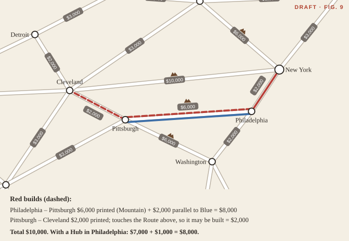

> **EXAMPLE.** Red builds Philadelphia – Pittsburgh (a Mountain Route, printed $6,000) and Pittsburgh – Cleveland (printed $2,000). Pittsburgh – Cleveland doesn't touch Red's Network, but it touches the other Route Red is building, so it's allowed.
>
> Blue already has track on Philadelphia – Pittsburgh, so Red's is parallel: $6,000 + $2,000 = $8,000. Pittsburgh – Cleveland is empty: $2,000. **Total: $10,000.**
>
> *With a Hub in Philadelphia:* both Routes get the Hub discount. Philadelphia – Pittsburgh touches the Hub ($8,000 − $1,000 = $7,000), and Pittsburgh is one Route from the Hub ($2,000 − $1,000 = $1,000). **Total: $8,000.**

> **IN THE APP.** Actions → Pay for track, and type what the Routes cost in total. The app takes the money; it doesn't check the prices, so say them out loud.

### Buy an Engine

*Bigger boilers, more driving wheels, faster runs.*

**Cost:** The Engine's price, less any trade-in.

This Action lets you buy the next Engine up the ladder.

- You may buy only the Engine **one level above the best Engine you own**. With a [Hub](#hub), you may instead buy two levels above, for $5,000 more.
- If you have one Engine, you may put the new one on your empty token, and keep both. Place it in any City in your Network; it may pick up a Commodity there.
- Or trade in an Engine you own. You get its trade-in value (half its price, rounded down to the nearest $1,000) off the new one. The token stays where it is, with its Cargo; only the engine type changes.
- If you have two Engines, you must trade one in.
- Your first 2-6-0 Mogul lets you claim Market Contracts. The first Mogul any player buys opens the Market.

| Level | Engine | Range | Price | Trade-in Value | Notes |
|---|---|---|---|---|---|
| 0 | 2-4-0 John Bull | 1 | (start) | $0 | |
| 1 | 4-4-0 American | 2 | $5,000 | $2,000 | |
| 2 | 2-6-0 Mogul | 3 | $7,000 | $3,000 | You may claim Market Contracts |
| 3 | 2-8-0 Consolidation | 4 | $10,000 | $5,000 | Opens the [Service Yard](#service-yard) for everyone |
| 4 | 2-6-2 Prairie | 5 | $14,000 | $7,000 | |
| 5 | 4-6-2 Pacific | 7 | $18,000 | $9,000 | |
| 6 | 2-8-2 Mikado | 8 | $22,000 | $11,000 | |
| 7 | 4-8-2 Mountain | 9 | $26,000 | $13,000 | Contracts it fulfills pay 1⅓× |
| 8 | 4-6-6-4 Challenger | 11 | $30,000 | $15,000 | Contracts it fulfills pay 1⅓×; +2 Railroad Ties at game end |

The 1⅓× bonus applies to the Contract's value only, rounded down to the nearest $1,000, and only when that Engine makes the delivery.

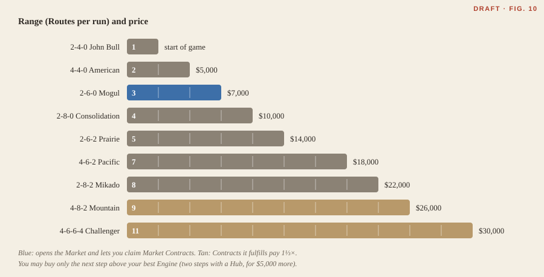

> **EXAMPLE.** Red owns a John Bull and an American, so Red's next Engine must be a Mogul ($7,000). Red has two choices:
>
> - Trade in the John Bull ($0): pay $7,000, and own an American and a Mogul.
> - Trade in the American ($2,000): pay $5,000, and own a John Bull and a Mogul.
>
> With a Hub, Red could skip the Mogul and buy a Consolidation for $10,000 + $5,000 = $15,000, less a trade-in.

> **IN THE APP.** Actions → Buy an engine lists the Engines you may buy.

### Buy an Upgrade

*Build the company behind the trains.*

**Cost:** The Upgrade's price, $10,000 to $20,000.

This Action lets you buy one Upgrade.

- You may own each Upgrade once.
- Some Upgrades have a condition before you may buy them, and some put a disc on the map. All nine are described in [Upgrades](#upgrades).

> **IN THE APP.** Actions → Buy an upgrade shows every Upgrade, its price, and whether you may buy it now.

### Acquire an Independent Railroad

*A small line, a fair price, a handshake.*

**Cost:** $3,000 per Route the Independent Railroad owns. Once any player has fulfilled a Contract in a Western Region, $4,000 per Route.

This Action lets you buy one Independent Railroad whose Cities touch your Network.

- At least one of its Cities must be in your Network.
- Its Routes become part of your Network ⚑Q5.
- You gain 1 Railroad Tie right away.

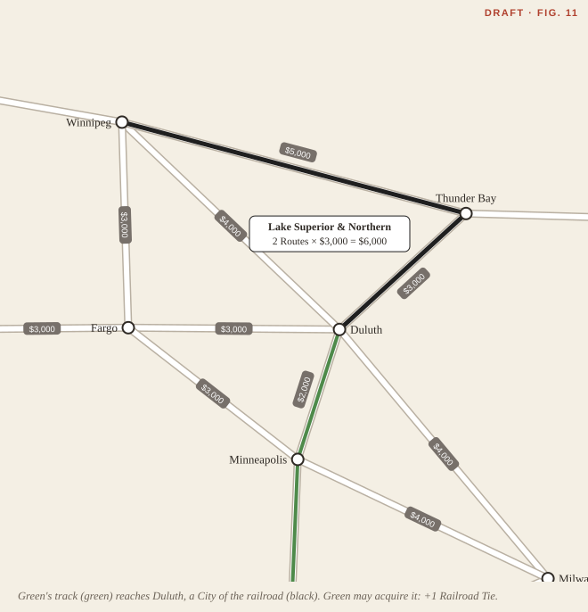

> **EXAMPLE.** Orange's track reaches Duluth. The *Lake Superior & Northern* owns Duluth – Thunder Bay and Thunder Bay – Winnipeg. Orange pays 2 × $3,000 = **$6,000** and gains 1 Railroad Tie. Orange's Engines can now run to Winnipeg.
>
> Had anyone already delivered to the West, it would cost 2 × $4,000 = $8,000.

> **IN THE APP.** Actions → Acquire a railroad lists every Independent Railroad with its Routes and the price.

### Borrow Money

**Cost:** None, now. Debt raises your [Debt Service](#debt-service).

This Action lets you borrow any multiple of $5,000. Add it to both your Cash and your Debt. There's no limit.

> **TIP.** Borrowing takes an Action, and so does what you buy with it. Borrow a little more than you need now, and you'll save an Action next time.

> **IN THE APP.** Press Loans at the top of the screen. Here you can review your Debt Service, borrow money, and repay your debt.

### Repay Debt

**Cost:** $5,000 or $10,000 of Cash.

This Action lets you pay back $5,000 or $10,000 of Debt, if you have $20,000 or more of Debt, as long as your Debt stays at $15,000 or more.

> **EXAMPLE.** Orange has $25,000 Debt. Orange may repay $5,000 (leaving $20,000) or $10,000 (leaving $15,000). At $15,000, Orange can't repay any more.

> **TIP.** Debt never drops below $15,000 once it's that high, and $5,000 or $10,000 of Debt can't be repaid at all. Borrowing is a commitment.

### Discard and Draw a New Contract

**Cost:** None.

This Action lets you discard your Private Contract and choose a new one from fresh offers: 2, plus 1 with a [Hub](#hub), plus 1 with a [Regional Office](#regional-office).

> **IN THE APP.** Actions → Discard and draw new contract.

### Go First Next Round

**Cost:** None.

Change the order of play starting with the next round so you go first. The order of play is not otherwise changed, and only one player may choose this action each round.

In this example, the play order is Red, Blue, Orange.

* Red takes their turn.
* Blue takes their turn, choosing Go First Next Round as one of their actions.
* Orange takes their turn. They cannot choose Go First Next Round because Blue already took it this round.
* The next round starts with Blue going first, followed by Orange and then Red.

Red could have selected Go First Next Round as one of their actions, which would not have changed the play order, but would have prevented Blue or Orange from choosing it. If Blue had not taken it and Orange had, then Orange gets two turns in a row: the end of the round where they chose the action, and the start of the next one.

---

## Upgrades

Each Upgrade is bought with the [Buy an Upgrade](#buy-an-upgrade) Action and lasts all game.

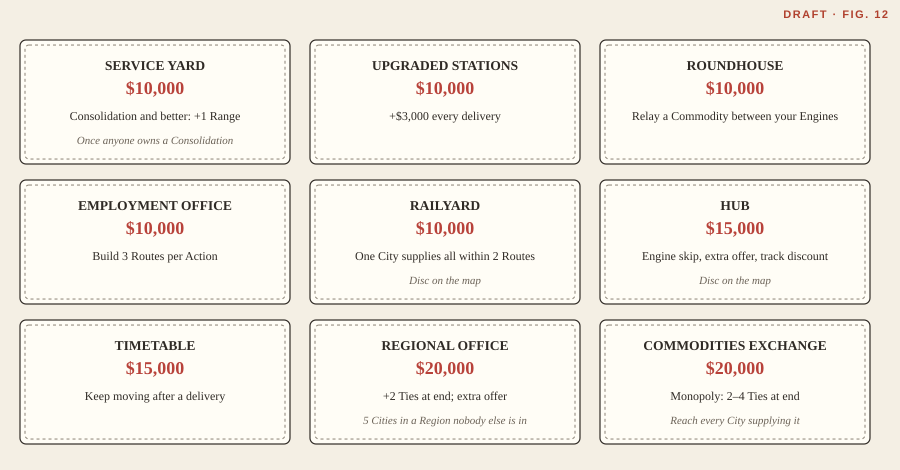

| Upgrade | Price | Condition | Marker on the map |
|---|---|---|---|
| [Service Yard](#service-yard) | $10,000 | Any player owns a Consolidation or better | — |
| [Upgraded Stations](#upgraded-stations) | $10,000 | — | — |
| [Roundhouse](#roundhouse) | $10,000 | — | — |
| [Employment Office](#employment-office) | $10,000 | — | — |
| [Railyard](#railyard) | $10,000 | A City in your Network with no Railyard | Railyard disc |
| [Hub](#hub) | $15,000 | A City in your Network that isn't another player's Hub | Hub disc |
| [Timetable](#timetable) | $15,000 | — | — |
| [Regional Office](#regional-office) | $20,000 | See below | Regional Office disc |
| [Commodities Exchange](#commodities-exchange) | $20,000 | See below | — |

### Service Yard

**Your 2-8-0 Consolidation and better Engines have +1 Range.**

You may buy it once any player owns a Consolidation or better.

### Upgraded Stations

**You receive $3,000 more for every Contract you fulfill.**

The $3,000 is added after the Mountain or Challenger bonus, so it isn't multiplied.

> **EXAMPLE.** Blue's Challenger fulfills a $9,000 Contract. 1⅓ × $9,000 = $12,000, plus $3,000 from Upgraded Stations: **$15,000**, before Debt Service.

### Hub

Put your Hub disc on a City in your Network, and choose the same City in the app. A City can be only one player's Hub.

Your Hub gives you four things:

1. **Engines:** you may buy an Engine two levels above your best, for $5,000 more. See [Buy an Engine](#buy-an-engine).
2. **Offers:** you get one more Private Contract offer each time you're offered new ones.
3. **Destinations:** your Hub City and the Cities next to it show up more often in your Private Contracts.
4. **Track:** each Route you build costs $1,000 less if either of its Cities is your Hub, or is one Route from your Hub on the map. Take the $1,000 off last, after parallel and Mountain costs. ⚑Q14

### Timetable

When an Engine fulfills a Contract, it doesn't have to stop. It may keep moving, up to its Range for the whole run.

### Roundhouse

Once each time you take Run Trains, your two Engines may relay a Commodity. ⚑Q18

1. Your first Engine carries a Commodity as far as you like, up to its Range.
2. Your second Engine must be empty. Move it **up to 4 Routes** to the City where the first Engine stopped.
3. The Commodity moves to the second Engine, which then runs normally from that City, up to its Range.

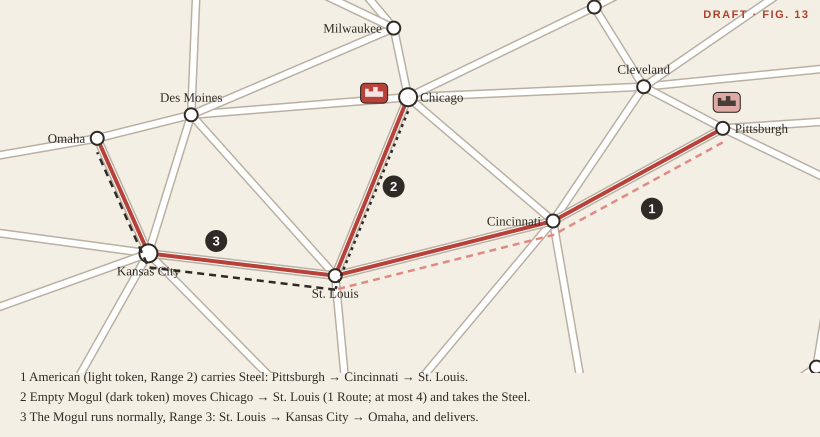

> **EXAMPLE.** Red's Private Contract is *Steel to Omaha: $9,000, 2 Railroad Ties*. Red's American (Range 2) picks up Steel in Pittsburgh and runs Pittsburgh → Cincinnati → Saint Louis **(1)**. Red's Mogul (Range 3), empty in Chicago, moves 1 Route to Saint Louis **(2)** and takes the Steel. Then it runs Saint Louis → Kansas City → Omaha **(3)** and fulfills the Contract.

### Employment Office

*(mid)* **Each Build Track Action, you may build 3 Routes instead of 2.**

### Railyard

*(mid)* Put your Railyard disc on a City in your Network. A City can have only one Railyard.

**Your Railyard City supplies you with every Commodity supplied within 2 Routes of it.** ⚑Q17

> **EXAMPLE.** Orange's Railyard is in Kansas City. For Orange, Kansas City also supplies Pork (Des Moines), Oil (Oklahoma City), Bauxite (Memphis), Lead and Sheep (Denver), Steel (Birmingham, via Memphis), Oil and Rice (Houston, via Santa Fe), and more.

### Regional Office

You may buy it if **both** are true:

- At least 5 Cities in one Region are in your Network, and
- No other player has a Route in that Region. A Route is in a Region when both its Cities are. ⚑Q16

Put your Regional Office disc on that Region's space on the map, and choose the same Region in the app.

Your Regional Office gives you two things:

1. **End of game:** +2 Railroad Ties.
2. **Offers:** each time you're offered Private Contracts, one extra offer is for a Commodity from that Region.

### Commodities Exchange

The Commodities Exchange gives you a Monopoly in one Commodity.

You may buy it for a Commodity once your Network reaches every City that supplies it, and only if no one else has a Monopoly in it. Only Commodities supplied by 4, 5 or 6 Cities can be monopolized:

| Cities supplying it | Commodities | Railroad Ties at game end |
|---|---|---|
| 4 | Cattle, Copper, Iron ore, Lead, Textiles | 2 |
| 5 | Grain, Imports | 3 |
| 6 | Coal, Machinery, Wood | 4 |

⚑Q3 ⚑Q13

> **IN THE APP.** The app asks which Commodity.

---

## End of the Round

After the last player in order ends their turn, the app ends the round:

1. **The Market ages.** Once the Market is open, each Market Contract that is counting down loses a round. One that runs out leaves the Market, and the app deals a replacement. Then the app may start one unclaimed Market Contract counting down from 5. If none has started in the last two rounds, one always does. A countdown shows on the Contract ("3 rounds left").
2. **Independent Railroads grow**, from the end of round 2 on. The app adds new Routes; one player draws them on the map with the black marker. Independent Railroads will never take a Mountain Route printed $10,000 or more.
3. **The Round Report** opens for everyone: a small map of each Independent Railroad that grew, with its new Routes in bold, and the Market Contracts that left and arrived.
4. **The next round starts.**

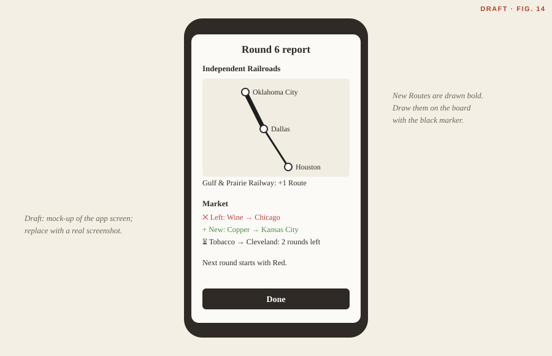

> **IN THE APP.** The round label in the top bar opens the latest Round Report. A dot means there's one you haven't seen.

---

## End of the Game

The game ends when a player has 30 or more Railroad Ties from fulfilled Contracts. When that happens, any players who have not yet played during the round take their turn.

Then every player adds these end-of-game bonuses to the Railroad Ties they earned during play:

| Bonus | Railroad Ties |
|---|---|
| **Breadth:** each different Commodity you've delivered | 1 each for the first 8; 2 each for the next 4; 3 each after 12 |
| **Depth:** your most-delivered Commodity | 1 + the number of times you delivered it |
| **Monopoly** ([Commodities Exchange](#commodities-exchange)) | 2, 3 or 4 |
| **[Regional Office](#regional-office)** | 2 |
| **West Coast** | 3 for building a route to any west coast city (see below) |
| **4-6-6-4 Challenger** | 2 |

The West Coast bonus is awarded to players who build a route to Vancouver, Seattle, Portland OR, San Francisco, Los Angeles,
or San Diego. The bonus is not multiplied for connecting to more than one of those cities; it is always just 3 points.

The player with the most Railroad Ties wins. If there is a tie, the player with the most routes wins. If there is still a
tie, the player with the most upgrades wins. If they are still tied, they share the victory.

> **EXAMPLE.** The game ends. Red has:
>
> | | Railroad Ties |
> |---|---|
> | Contracts fulfilled (14 deliveries) | 30 |
> | 2 Independent Railroads acquired | 2 |
> | Breadth: 10 different Commodities (8 × 1, then 2 × 2) | 12 |
> | Depth: Coal, delivered 4 times (1 + 4) | 5 |
> | Monopoly in Coal (6 Cities) | 4 |
> | Regional Office | 2 |
> | **Total** | **55** |

> **TIP.** The app shows Railroad Ties from Contracts and acquisitions. Count the end-of-game bonuses together at the table.

---

## Fine Print

**The app and this book.** While the game is in playtest, if the app and this book disagree, play what the app allows and tell the designers.

**Public and secret.** Everything is public except the Private Contract offers you do not take.

**Words with fixed meanings.** *May* means you choose. *Must* means you have to. *Right away* means before anything else happens.

**Cash and Debt.** Cash never goes below $0 and is always a multiple of $1,000. Debt is always a multiple of $5,000.

**Limits.** You own at most 2 Engines, hold 1 Private Contract and at most 1 claimed Market Contract, and own each Upgrade once. There's no limit on track, Debt or Independent Railroads.

**Mistakes.** If you notice a mistake during your turn, Undo and replay it. If it's noticed later, agree on a fix with the other players and move on.

---

## Rules in Development

These are planned but not in the playtest yet. Don't play them unless the designer asks you to.

- **Bankruptcy:** what happens when you can't pay Debt Service. For now, the app blocks the delivery and you borrow first.

---

## Questions and Answers

**Can I run the same Engine twice in one turn?**
No. Each Engine runs once per turn. You may take Run Trains twice to run each Engine in a separate Action. See [Run Trains](#run-trains).

**Does picking up a Commodity use some of my Range?**
No. Picking up is a Free Action. See [Free Actions](#free-actions).

**My Engine passes through the destination City. Do I have to deliver?**
No, fulfilling is optional. If you do, the Engine stops there, unless you have a [Timetable](#timetable).

**Can my Engines use other players' track?**
No, only your own Network.

**Can I build on a Route an Independent Railroad owns?**
No. You can acquire the railroad instead. See [Acquire an Independent Railroad](#acquire-an-independent-railroad).

**Can I keep my John Bull when I buy an American?**
Yes. Put the American on your empty token. See [Buy an Engine](#buy-an-engine).

**I have $5,000 of Debt. Can I repay it?**
No. You may repay only from $20,000 of Debt, and never below $15,000. See [Repay Debt](#repay-debt).

**A delivery would cost me more in Debt Service than it pays. Can I still make it?**
Yes, if your Cash covers the difference. If it doesn't, borrow first.

**The Market is empty. Why?**
It opens when the first player buys a 2-6-0 Mogul or better.

**Do Railroad Ties from Independent Railroads count toward 30?**
No. Only Railroad Ties from Contracts end the game.

---

## Glossary

| Term | Meaning | See |
|---|---|---|
| **Action** | One of the 8 things you do on your turn; you take up to 2. | [Your Turn](#your-turn) |
| **Cargo** | The Commodity an Engine is carrying (at most 1). | [Core Concepts](#commodities-and-cargo) |
| **Cash** | Money you have. Never below $0. | [Money](#money) |
| **Central Regions** | North Central and South Central. | [Regions](#regions) |
| **City** | A circle on the map. | [Cities and Routes](#cities-and-routes) |
| **Claim** | Reserve a Market Contract for yourself. | [Claiming a Market Contract](#claiming-a-market-contract) |
| **Commodity** | A good a City supplies. | [Commodities and Cargo](#commodities-and-cargo) |
| **Contract** | A Commodity and a destination City; pays Cash and Railroad Ties when fulfilled. | [Contracts](#contracts) |
| **Debt** | Money you've borrowed. A multiple of $5,000. | [Borrow Money](#borrow-money) |
| **Debt Service** | $1,000 per $5,000 of Debt, due on some deliveries. | [Debt Service](#debt-service) |
| **Engine** | A token plus its engine type in the app. | [Buy an Engine](#buy-an-engine) |
| **Free Action** | Something you may do on your turn without using an Action. | [Free Actions](#free-actions) |
| **Fulfill** | Deliver a Contract's Commodity to its destination. | [Fulfilling a Contract](#fulfilling-a-contract) |
| **Independent Railroad** | A Route network run by the app, drawn in black. | [Acquire an Independent Railroad](#acquire-an-independent-railroad) |
| **Market** | The 3 open Market Contracts. | [Contracts](#contracts) |
| **Market Contract** | A Contract any player may claim. | [Contracts](#contracts) |
| **Monopoly** | Exclusive ownership of a Commodity, from the Commodities Exchange. | [Commodities Exchange](#commodities-exchange) |
| **Mountain Route** | A Route with a mountain symbol; its price is doubled. | [Cities and Routes](#cities-and-routes) |
| **Network** | Your track plus your acquired Independent Railroads. | [Your Network](#your-network) |
| **Parallel track** | A Route you build that another player has already built. | [Build Track](#build-track) |
| **Private Contract** | Your secret Contract. You always have one. | [Contracts](#contracts) |
| **Railroad Ties** | Victory points. | [Railroad Ties](#railroad-ties) |
| **Range** | How many Routes an Engine moves when it runs. | [Engines](#engines) |
| **Region** | One of six areas of the map. | [Regions](#regions) |
| **Route** | The line between two neighboring Cities. Engine cards and the app call it a *segment*. | [Cities and Routes](#cities-and-routes) |
| **Starting Route** | Your first Route, chosen in setup. | [Setup](#setup) |
| **Trade-in Value** | Half an Engine's price, rounded down to $1,000. | [Buy an Engine](#buy-an-engine) |
| **Upgrade** | A permanent advantage you buy. | [Upgrades](#upgrades) |
| **Western Regions** | Northwest and Southwest. | [Regions](#regions) |

---

## Index

**A** Actions, [list](#actions) · Acquire an Independent Railroad, [rule](#acquire-an-independent-railroad); price after a Western delivery, [rule](#acquire-an-independent-railroad)
**B** Bankruptcy, [in development](#rules-in-development) · Borrow Money, [rule](#borrow-money) · Breadth bonus, [scoring](#end-of-the-game) · Build Track, [rule](#build-track)
**C** Cargo, [defined](#commodities-and-cargo); recording, [Free Actions](#free-actions) · Challenger, [ladder](#buy-an-engine), [scoring](#end-of-the-game) · Claiming, [rule](#claiming-a-market-contract) · Commodities Exchange, [rule](#commodities-exchange) · Contracts, [defined](#contracts); value, [Key Concept](#contracts)
**D** Debt Service, [rule](#debt-service) · Depth bonus, [scoring](#end-of-the-game) · Discard and Draw a New Contract, [rule](#discard-and-draw-a-new-contract)
**E** Employment Office, [rule](#employment-office) · End of the Game, [rule](#end-of-the-game) · End of the Round, [rule](#end-of-the-round) · Engines, [ladder](#buy-an-engine)
**F** Free Actions, [list](#free-actions) · Fulfilling a Contract, [rule](#fulfilling-a-contract)
**H** Hub, [rule](#hub); engine skip, [Buy an Engine](#buy-an-engine); track discount, [Hub](#hub)
**M** Market, [defined](#contracts); opening, [Buy an Engine](#buy-an-engine); expiring, [End of the Round](#end-of-the-round) · Mistakes, [Fine Print](#fine-print) · Mogul, [ladder](#buy-an-engine) · Monopoly, [Commodities Exchange](#commodities-exchange) · Mountain (engine), [ladder](#buy-an-engine) · Mountain Route, [defined](#cities-and-routes); cost, [Build Track](#build-track)
**N** Network, [defined](#your-network)
**P** Parallel track, [Build Track](#build-track) · Player order, [Setup](#setup) · Private Contract, [defined](#contracts)
**R** Railroad Ties, [defined](#railroad-ties); per Contract, [Key Concept](#contracts) · Railyard, [rule](#railyard) · Regional Office, [rule](#regional-office) · Regions, [defined](#regions) · Repay Debt, [rule](#repay-debt) · Round Report, [End of the Round](#end-of-the-round) · Roundhouse, [rule](#roundhouse) · Run Trains, [rule](#run-trains)
**S** Service Yard, [rule](#service-yard) · Setup, [rule](#setup) · Starting Routes, [Setup](#setup)
**T** Timetable, [rule](#timetable) · Trade-in Value, [Buy an Engine](#buy-an-engine)
**U** Undo, [Free Actions](#free-actions) · Upgraded Stations, [rule](#upgraded-stations) · Upgrades, [table](#upgrades)
